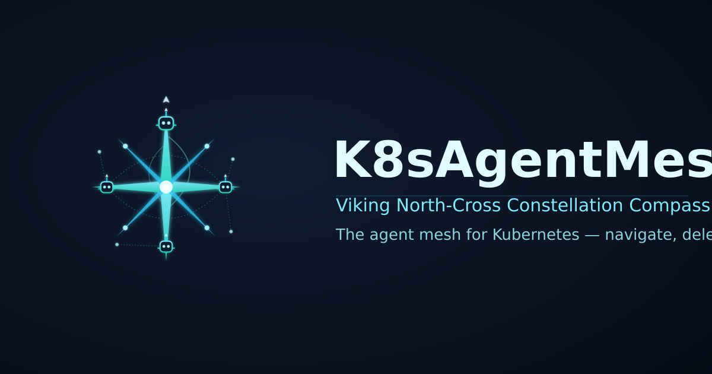

# K8sAgentMesh

  

K8sAgentMesh is the runtime-agnostic **AgentMesh** seam: the generic mesh
surfaces of the AgentMesh architecture (approved chapter §1A/§9.3) that any
platform can host for standing AI coding agents on Kubernetes.

## What lives here

| Package | Contents |
|---|---|
| `mesh` | RuntimeAdapter 7-op contract (Spawn / Register / Route / Hibernate / Wake / Stop / Recreate), per-pod Gateway process manager, router, lifecycle state machine, child-process substrate, runtime adapters; Supervisor-side registration seams — `Registry` store interface, registration `Ingress`, TTL-prune `Sweeper`, health-sweep `SupervisorHealth` loop, route-to-endpoint selection |
| `a2a` | A2A wire types (Task / Event / Status / AgentCard / ModelRoute) |

## Hosts, not owners

K8sAgentMesh is host-agnostic by design. **k8squad is host #1** (the reference
adopter): its role-based scheduling plugs in as a POLICY on the mesh scheduling
interface; CRD shapes, `coord.*` guards, telemetry spine, board/SCM and memory
stay host-side behind the seam. A second adopter maps the same elements onto
its own equivalents.

## Extraction-clean rule

No package in this module may import `github.com/K8squad/K8squad/*`. The guard
runs in CI (`hack/extraction-clean.sh`).

## Status

P3 extraction in progress — stories P3.1–P3.7 under the K8squad roadmap
tracking issue. The code is lifted, not rewritten, from the proven seam in
k8squad (P1 prototype + P2 second-adapter proof: zero control-plane change).

## License

Apache-2.0 — see [LICENSE](LICENSE).
