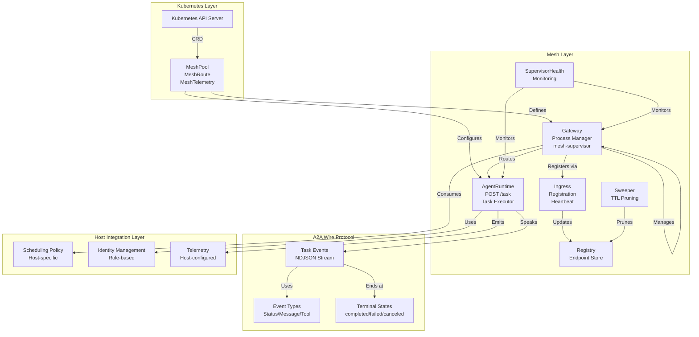
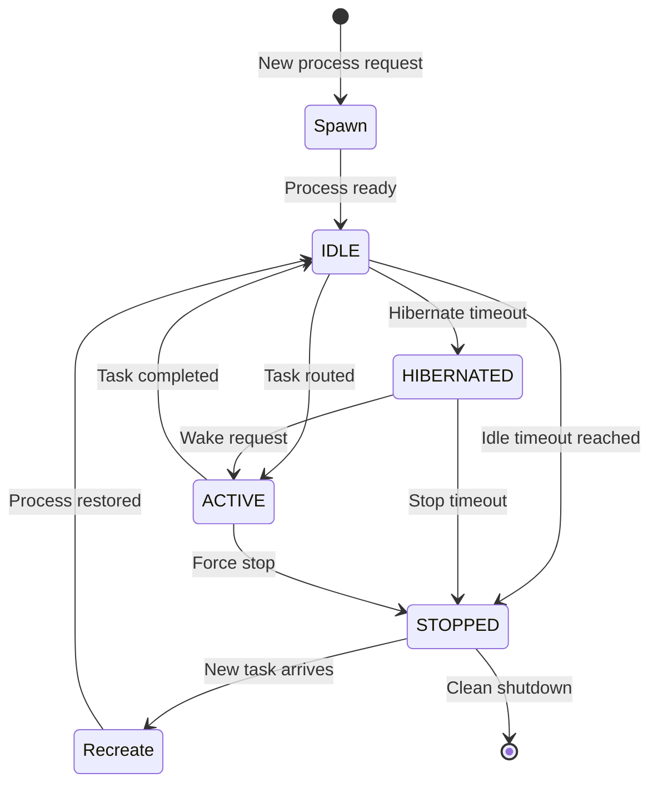
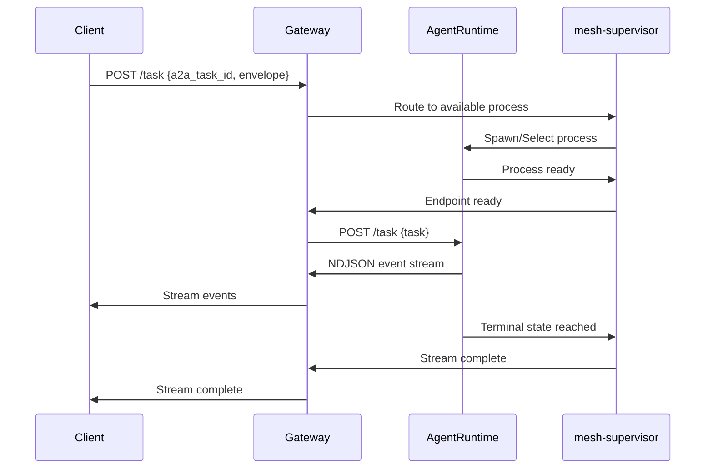

# Architecture

K8sAgentMesh is built around a clean architecture with well-defined interfaces and contracts. This document covers the core architectural patterns, components, and protocols that make up the mesh.

## Component Overview

The mesh consists of several key components working together to provide a runtime-agnostic AgentMesh substrate:



## RuntimeAdapter 7-Op Contract

The heart of the mesh is the `RuntimeAdapter` interface, which defines a 7-operation contract that platforms must implement to integrate with the mesh:

```go
type RuntimeAdapter interface {
    // Spawn creates a new standing process for the given team/role
    Spawn(ctx context.Context, req SpawnRequest) (*SpawnResult, error)
    
    // Register makes a process's endpoint available for routing
    Register(ctx context.Context, req RegisterRequest) (*RegisterResult, error)
    
    // Route delivers a task to a process and returns an event stream
    Route(ctx context.Context, req RouteRequest) (Stream, error)
    
    // Hibernate pauses a running process but keeps its state
    Hibernate(ctx context.Context, req HibernateRequest) (*HibernateResult, error)
    
    // Wake resumes a hibernated process
    Wake(ctx context.Context, req WakeRequest) (*WakeResult, error)
    
    // Stop terminates a process and cleans up resources
    Stop(ctx context.Context, req StopRequest) (*StopResult, error)
    
    // Recreate rebuilds a process from its envelope state
    Recreate(ctx context.Context, req RecreateRequest) (*RecreateResult, error)
}
```

### Contract Operations

| Operation | Purpose | Key Parameters | Lifecycle Stage |
|-----------|---------|---------------|-----------------|
| **Spawn** | Create new standing process | team, role, config | Process Creation |
| **Register** | Make endpoint available for routing | endpointID, endpoint, agentCard | Registration |
| **Route** | Deliver task to process | task, endpoint selection | Task Execution |
| **Hibernate** | Pause but preserve state | processID, timeout | Resource Optimization |
| **Wake** | Resume hibernated process | processID | Resource Recovery |
| **Stop** |  Terminate and cleanup | processID, graceful | Resource Reclamation |
| **Recreate** | Restore from envelope state | envelope, config | Recovery |

### Runtime Adapters

Adding a runtime is a new `RuntimeSpec` plus a constructor with **zero
control-plane change** — the standing acceptance test since P2. Five adapters
ship today:

| # | Runtime | Adapter | Wire Router | Hibernate/Wake | Notes |
|---|---------|---------|-------------|----------------|-------|
| 1 | opencode | `mesh/opencode.go` | HTTP `/task` | SIGSTOP/SIGCONT (base) | the seam's proof |
| 2 | codex | `mesh/codex.go` | HTTP `/task` | SIGSTOP/SIGCONT (base) | second runtime, no control-plane diff |
| 3 | vibe | `mesh/vibe.go` | HTTP `/task` | SIGSTOP/SIGCONT (base) | uv/Python toolchain image concern |
| 4 | goose | `mesh/goose.go` | HTTP `/task` | SIGSTOP/SIGCONT (base) | multi-provider lanes, spike-locked env |
| 5 | crewai | `mesh/crewai.go` | `crewaiRouter` (Google A2A 0.3.x JSON-RPC+SSE) | **cooperative no-ops** | first non-CLI framework; wire translated at the adapter seam (R11); always-on band; see [CrewAI integration](crewai-integration.md) |

CrewAI is the first adapter whose standing process speaks a **foreign wire**
(Google A2A) rather than the module `/task` surface — the translation lives
entirely in its Router, so the gateway never learns a protocol exists.

## Per-Pod Gateway Process Manager

The `Gateway` component manages standing processes per pod, providing:

### Process Lifecycle


### Gateway Features
- **Process Pool Management** - Maintains standing processes with configurable min/max
- **Health Monitoring** - Tracks process health and automatic restart
- **Resource Optimization** - Automatic hibernation of idle processes
- **Overflow Handling** - Configurable policies for handling saturation

## Router Component

The `Router` handles task delivery to standing processes:

```go
type Router interface {
    // Route POSTs the task to the process serving at endpoint and returns
    // a Stream of its events
    Route(ctx context.Context, endpoint string, task a2a.Task) (Stream, error)
}
```

### Router Responsibilities
- **Transport Abstraction** - Pluggable delivery mechanisms (HTTP, in-process, etc.)
- **Endpoint Selection** - Routes to appropriate process based on policy
- **Stream Management** - Handles NDJSON event streams from processes
- **Error Handling** - Manages transport failures and process unavailability

## A2A Wire Protocol

The mesh uses a stable A2A (Agent-to-Agent) wire protocol for communication:

### Task Flow


### Event Types
```json
{
  "seq": 1,
  "a2a_task_id": "task-123",
  "type": "status",
  "payload": {
    "state": "working"
  }
}
```

### Terminal States
Tasks end in one of three terminal states:
- **`completed`** - Task finished successfully
- **`failed`** - Task encountered an error
- **`canceled`** - Task was canceled externally

## Supervisor Seams

The mesh provides several supervisor-side services through well-defined seams:

### Registry
```go
type Registry interface {
    // Store and retrieve process endpoints
    Upsert(ctx context.Context, endpoint Endpoint) error
    Get(ctx context.Context, id string) (*Endpoint, error)
    List(ctx context.Context, filter Filter) ([]Endpoint, error)
    Prune(ctx context.Context, cutoff time.Time) error
}
```

### Ingress
HTTP surface for gateway registration:
- **POST /mesh/register** - Registration and heartbeat
- **POST /mesh/deregister** - Clean shutdown
- **GET /mesh/health** - Liveness probe

### Sweeper
TTL-based pruning of unhealthy endpoints with configurable intervals.

### SupervisorHealth
Health monitoring loop for processes and overall mesh health.

## CRD Posture (Tier A/B/C)

The mesh follows a thin, host-agnostic CRD posture with clear tiers:

### Tier A - Shipped with Mesh
Mesh-owned CRDs consumed directly by mesh code:

| CRD | Purpose | Fields |
|-----|--------|---------|
| **MeshPool** | Standing process configuration | min, max, overflowPolicy, team, role |
| **MeshRoute** | Task routing strategy | strategy, recreateSLO, fallback |
| **MeshTelemetry** | Telemetry configuration | emitter, metricNamespace |

### Tier B - Go Contract Types
Go types defining mesh interfaces, not CRDs:

| Type | Purpose |
|------|---------|
| **MeshEndpoint** | Registration record behind Registry interface |
| **Lifecycle Events** | Schema for lifecycle events |

### Tier C - Never Mesh-Owned
Host-specific concerns never owned by the mesh:

- Identity CRDs (Role, AgentRuntime, RolePool, Team, ModelConfig)
- Scheduling policy configuration
- OtelConfig spine
- coord.* custody guards
- Per-team rollout flags

This tiered approach ensures the mesh remains thin and host-agnostic while providing the essential contracts needed for operation.